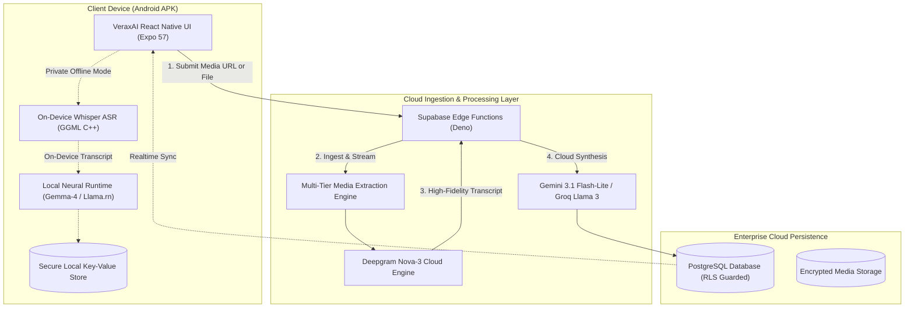

````markdown
<div align="center">

# VeraxAI (Release Distribution)

### Universal Hybrid Audio Intelligence & On-Device Neural Synthesis Engine

[](https://github.com/AlexBuildsLTS/VeraxAI-Release/releases)
[](https://github.com/AlexBuildsLTS/VeraxAI-Release/releases)
[](https://expo.dev)
[](https://reactnative.dev)
[](https://github.com/AlexBuildsLTS/VeraxAI-Release)
[](https://github.com/AlexBuildsLTS/VeraxAI-Release)

<br/>

<p align="center">
  <a href="https://github.com/AlexBuildsLTS/VeraxAI-Release/releases/latest">
    
  </a>
</p>

_This repository distributes compiled binary releases, installation guides, verification hashes, and changelogs for VeraxAI. Core proprietary source code remains private._

</div>

---

## 📌 Executive Overview

**VeraxAI** is an industrial-grade audio intelligence platform engineered for real-time transcription, sound analysis, and automated contextual synthesis. By uniting **high-throughput cloud orchestration** with **100% on-device private neural execution**, VeraxAI processes complex spoken and audiovisual media into structured intelligence with zero server-side telemetry retention when operated in privacy mode.

### Key Capabilities

- **Hybrid Neural Topologies**: Run ultra-fast cloud synthesis via **Gemini 3.1 Flash-Lite** and **Groq Llama 3**, or switch to 100% offline, privacy-preserving local LLM inference (**Gemma-4 / Llama 3** via native C++ runtimes).
- **High-Accuracy Speech-to-Text (ASR)**: Native on-device **Whisper.cpp (GGML)** acceleration combined with cloud Deepgram Nova-3 failover.
- **Universal Stream Ingestion**: Multi-protocol extraction engine supporting raw audio/video files, YouTube streams, and web media URLs.
- **Comprehensive Export Matrix**: Export actionable intelligence to formatted Markdown, Plain Text, SubRip (`.srt`), WebVTT (`.vtt`), and typed JSON schema payloads.

---

## 🏗️ System Architecture


````

---

## ⚡ Feature Matrix

| Feature                  |       Local / Offline Mode        |         Cloud Synthesis Mode         |
| :----------------------- | :-------------------------------: | :----------------------------------: |
| **Speech-to-Text (ASR)** |        Native Whisper GGML        |   Deepgram Nova-3 / Whisper Cloud    |
| **Inference Engine**     |      Local Gemma-4 / Llama 3      | Gemini 3.1 Flash-Lite & Groq Llama 3 |
| **Internet Required**    |      ❌ No (100% Air-Gapped)      |                ✅ Yes                |
| **Latency Profile**      | Real-time on-chip (SoC-dependent) | Sub-second streaming cloud response  |
| **Data Privacy**         |     100% Zero-Cloud Footprint     |   TLS 1.3 / E2E Encrypted Transit    |
| **Export Formats**       |      TXT, MD, SRT, VTT, JSON      |       TXT, MD, SRT, VTT, JSON        |

---

## 📱 Hardware & Compatibility Specifications

VeraxAI compiles high-performance C++ binaries (`whisper.cpp`, `llama.cpp`, and Google Skia) directly against the Android NDK.

### Minimum Android Requirements

- **OS Version**: Android 8.0 (Oreo, API Level 26) or higher.
- **Supported Architectures**: `arm64-v8a` (recommended), `armeabi-v7a`, `x86_64`.
- **RAM**: 4 GB RAM minimum.
- **Free Storage**: ~150 MB for core installation (additional storage required if downloading local GGUF models).

### Recommended Specs for Local LLM Synthesis

- **Chipset**: Qualcomm Snapdragon 8 Gen 1+ / MediaTek Dimensity 9000+ / Google Tensor G2+.
- **RAM**: 8 GB+ RAM for seamless concurrent Gemma/Llama 4-bit quantized execution.

---

## 📥 Download & Installation

### Option 1: Direct APK Download (Recommended)

1. Download the latest release binary from the [Releases Page](https://github.com/AlexBuildsLTS/VeraxAI-Release/releases/latest).
2. On your Android device, open the downloaded `.apk` file.
3. If prompted, toggle **"Allow installation from unknown sources"** in your Android Security Settings.
4. Complete the installation and launch **VeraxAI**.

### Option 2: Installation via Android Debug Bridge (ADB)

If installing from a workstation or development computer:

```bash
# Connect device with USB Debugging enabled
adb devices

# Install the release APK with replace & grant-permissions flags
adb install -r -g VeraxAI-v1.0.0-preview.apk
```

---

## 🔐 Binary Verification & Checksums

Always verify the integrity of downloaded distribution packages before installation:

```bash
# Verify SHA-256 hash on Linux / macOS
sha256sum VeraxAI-v1.0.0-preview.apk

# Verify SHA-256 hash on Windows PowerShell
Get-FileHash -Algorithm SHA256 .\VeraxAI-v1.0.0-preview.apk
```

| File                         | SHA-256 Checksum                                                     |
| :--------------------------- | :------------------------------------------------------------------- |
| `VeraxAI-v1.0.0-preview.apk` | _Check official release assets on GitHub Releases for matching hash_ |

---

## 📋 Release Notes & Changelog

### Version `1.0.0-preview`

- **Core Engine**: Fully unified cross-platform Expo SDK 57 / React Native 0.86.3 runtime.
- **ASR Layer**: Integrated `whisper.rn` 0.6.0 with multi-core Android native CMake build.
- **Local Inference**: Embedded `llama.rn` engine with Gemma-4 and Llama 3 GGUF quantization support.
- **Cloud Synthesis**: Production integration with Gemini 3.1 Flash-Lite and Groq Llama 3 via Supabase Edge Functions.
- **Visuals**: Full hardware-accelerated fluid UI powered by `@shopify/react-native-skia` and `react-native-reanimated` worklets.

---

## 🗺️ Project Roadmap

- [x] Initial Android Standalone Release (APK Preview)
- [ ] Google Play Store Beta Distribution
- [ ] iOS App Store Production Build (TestFlight)
- [x] Web Client Deployment via Vercel (Edge WASM runtime)
- [x] Multi-lingual speech diarization with speaker identification
- [x] Hardware-quantized 2-bit Gemma on-device micro-models

---

## 💬 Community, Feedback & Support

Found an issue with the preview build, or have feature requests?

- **Bug Reports**: Open an issue on our [Issue Tracker](https://github.com/AlexBuildsLTS/VeraxAI-Release/issues).
- **Maintainer**: [@AlexBuildsLTS](https://github.com/AlexBuildsLTS)

---

<div align="center">
  <sub>Built with precision by AlexBuilds. VeraxAI is proprietary software. All distribution binaries are signed and copyrighted.</sub>
</div>
```
