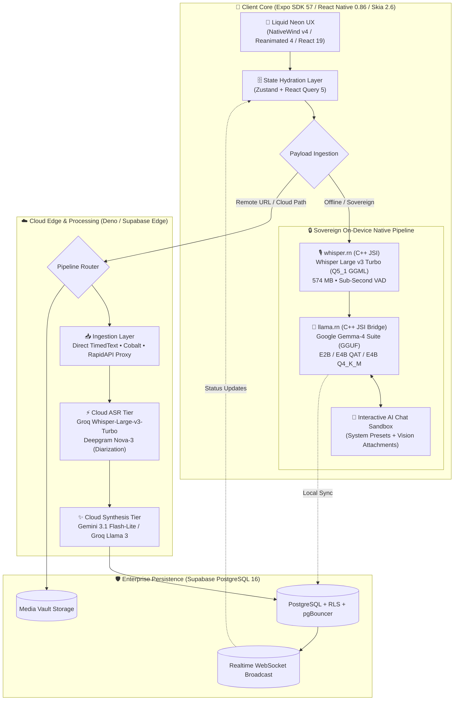
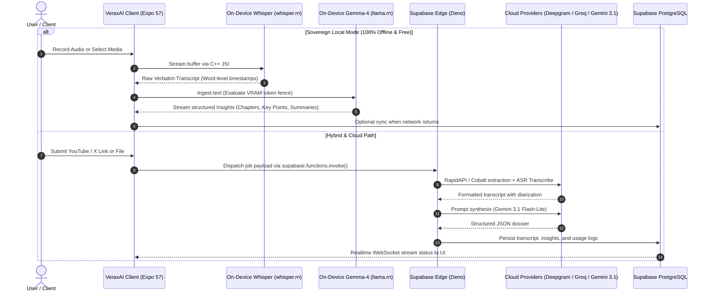
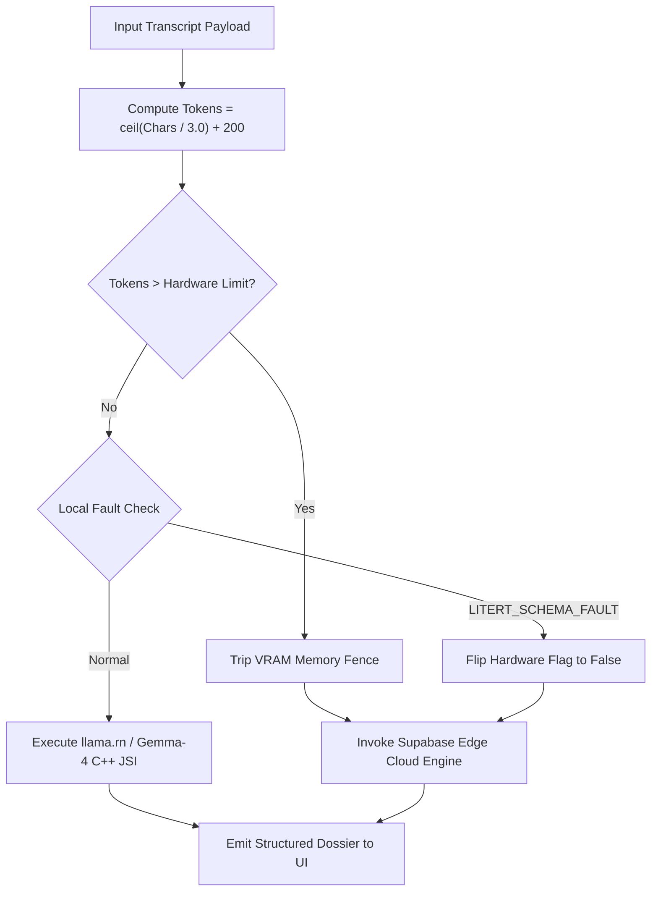
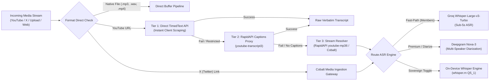

# ⚡ VeraxAI — Universal Hybrid Audio Intelligence & On-Device Neural Synthesis Engine

[%20%7C%20Android%20(APK)%20%7C%20iOS%20(App%20Store)-0A0D14.svg?style=flat-square&logo=expo&logoColor=00F0FF)](https://expo.dev)
[](https://reactnative.dev)
[](https://react.dev)
[](https://pnpm.io)
[-10B981.svg?style=flat-square&logo=openai)](https://github.com/ggerganov/whisper.cpp)
[-8A2BE2.svg?style=flat-square&logo=google)](https://ai.google.dev/gemma)
[-3B82F6.svg?style=flat-square)](https://www.apache.org/licenses/LICENSE-2.0)
[](https://deepgram.com)
[](https://shopify.github.io/react-native-skia/)

---

## 📌 Executive Overview

**VeraxAI** is an enterprise-grade, cross-platform audio intelligence orchestration engine engineered for real-time transcription, contextual insight generation, multimodal content analysis, and sovereign offline neural synthesis. It bridges low-latency edge computing with high-throughput cloud clusters, delivering deterministic execution across **Web (Vercel)**, **Android (Google Play / Direct APK)**, and **iOS (App Store)**.

VeraxAI features a **Dual-Engine Zero-Cloud Offline Mode**: devices can run both on-device Speech-to-Text (**OpenAI Whisper Large v3 Turbo**) and on-device Reasoning (**Google Gemma-4 Suite**) simultaneously on your phone's native hardware. Zero bytes leave the client SoC, delivering total cryptographic privacy, zero API bills, and resilience against network outages under the permissive **Apache 2.0 license**.

| 🎙️ Universal Ingestion | 🧠 Hybrid Neural Topologies | ⚡ Interactive AI Sandbox |
| :--- | :--- | :--- |
| • YouTube, X (Twitter), Web media URLs<br/>• Cobalt & RapidAPI extraction proxies<br/>• Direct high-resolution audio & video uploads | • 100% Offline Device Synthesis (Gemma-4)<br/>• Cloud Fast-Path (Groq LPU Llama 3)<br/>• Cloud Premium (Deepgram Nova-3 & Gemini 3.1) | • Multi-turn local conversational chat<br/>• System architecture prompts & presets<br/>• VRAM memory fencing & failover safety |

---

## 🏗️ System Architecture & Runtime Topology

VeraxAI routes media payloads through an intelligent extraction and inference matrix. When network connectivity is constrained or sovereign mode is enforced, the app dynamically locks memory fences and executes on-device native C++ JSI models.

### End-to-End Execution Topology



---

## 🔄 Sequence Workflow: Cloud vs. Sovereign Local Handoff



---

## 🧠 Sovereign On-Device AI Engine: Gemma-4 & Whisper

VeraxAI enables dual on-device inference: audio decoding and transcript reasoning execute completely within local device RAM and NPU/GPU hardware.

### 1. The On-Device LLM Matrix (Gemma-4 Suite)

Google's **Gemma-4** architecture represents a state-of-the-art open-weights model family. Released under the permissive **Apache 2.0 license**, it allows unlimited offline execution with no licensing royalties, strict privacy compliance (HIPAA/GDPR-ready), and zero surveillance telemetry.

| Model Identifier | Quant Type | Size | Min RAM | Recommended Hardware | Target Execution Scope |
| :--- | :--- | :--- | :--- | :--- | :--- |
| **Gemma-4 E2B** *(Unsloth Fast)* | Q4_K_XL | 3.0 GB | 4 GB | Mid-range Android / iOS | Ultra-fast chaptering, mobile summaries, quick chat |
| **Gemma-4 E4B QAT ★** *(Unsloth Dynamic)* | UD-Q2_K_XL | 3.2 GB | 6 GB | Flagships & High-end SoCs | Near-bf16 reasoning quality, low VRAM, deep synthesis |
| **Gemma-4 E4B** *(Quality Master)* | Q4_K_M | 4.6 GB | 8 GB | Flagships & Desktop Web | Maximum reasoning capacity, technical & legal analysis |

#### ★ The Unsloth Dynamic QAT Breakthrough: Gemma-4 E4B (UD-Q2_K_XL)

The **Gemma-4 E4B QAT (UD-Q2_K_XL)** utilizes **Quantization-Aware Training (QAT)** combined with **Unsloth Dynamic Quantization**:

- **Near-bfloat16 Accuracy**: Minimizes perplexity degradation typical of standard 2-bit/3-bit quantizations.
- **Footprint Reduction**: Compresses a 4-billion parameter class engine down to **3.2 GB**, fitting comfortably on devices with 6 GB or 8 GB RAM.
- **Thermal Efficiency**: Reduces memory bandwidth pressure, allowing higher tokens-per-second generation and lower battery drain during long transcript synthesis.

### 2. On-Device Speech-to-Text: Whisper Large v3 Turbo (Q5_1)

- **Engine**: GGML binary executed through native C++ JSI bindings via `whisper.rn`.
- **Model Profile**: OpenAI Whisper Large-v3-Turbo quantized to **Q5_1** (0.574 GB / ~574 MB).
- **SoC Footprint**: Runs in ~600 MB RAM, enabling smooth operation on mid-range devices from 2022 onwards.
- **Zero-Cloud Parity**: Works with local audio (MP3, WAV, M4A, AAC, FLAC, OGG, MP4) and immediately routes raw transcripts into the active Gemma-4 model.

### 3. VRAM Fencing & Memory Protection Formula

To prevent out-of-memory (OOM) fatal crashes on mobile SoCs, the native bridge calculates prompt text density prior to model pre-fill using the calibrated Gemma metric:

$$\text{Tokens} = \left\lceil \frac{\text{Characters}}{3.0} \right\rceil + 200$$

If calculated tokens exceed the calibrated hardware prefill allocation (`prefillTokens`), execution bypasses local inference and triggers graceful cloud handoff via Deno Edge Functions.



---

## 💬 Interactive AI Chat Sandbox

VeraxAI includes an on-device conversational environment directly linked to the active local model:

- **System Architecture Injection**: Configure pre-prompt behavioral parameters (e.g., _concise editor_, _technical auditor_, _creative synthesizer_) prior to turn execution.
- **Preset Vault**: Save, load, and delete system instructions locally via `@verax_saved_prompts_v1`.
- **Multimodal Visual Context**: Attach images to chat turns using hardware-accelerated previews.
- **Live Token Streaming**: Token-by-token emission powered by Reanimated worklet throttles.
- **Cross-Platform Session Export**: Export complete chat sessions to markdown, clipboard, or native OS share sheets.
- **Web LM Studio Integration**: For browser testing on Web (Vercel), connect directly to local desktop models running via LM Studio at `http://127.0.0.1:1234/v1`.

---

## 🌐 Universal Media Ingestion & Extraction Matrix

VeraxAI resolves media streams from multiple external providers through an automated fallback waterfall:



---

## 🛠️ Production Technology Stack

| Tier | Core Technology | Production Role |
| :--- | :--- | :--- |
| **Framework** | Expo SDK 57 (`v57.0.26`) | Universal mobile & web runtime |
| **React Core** | React 19.2.3 / React Native 0.86.3 | React compiler & concurrent engine |
| **Package Manager** | pnpm 9.x+ (Hoisted Runtime) | Deterministic dependency tree & build cache |
| **Styling Engine** | NativeWind v4 (Tailwind CSS 3.4.19) | Universal CSS-to-native compilation |
| **Canvas & Motion** | React Native Skia 2.6.2 | GPU-accelerated canvas rendering |
| **Animations** | Reanimated 4.5.1 + Worklets Core | 120 FPS UI-thread fluid physics |
| **State Management** | Zustand 4.5.7 + TanStack Query 5.104 | Global machine state & query caches |
| **Database & Storage** | Supabase (PostgreSQL 16, pgBouncer, RLS) | Tenant isolation & encrypted media vault |
| **Edge Runtime** | Deno 2.x Edge Functions | Serverless ingestion & API relays |
| **On-Device LLM** | `llama.rn` (v0.12.9) / Gemma-4 C++ JSI | Local GGUF neural reasoning |
| **On-Device ASR** | `whisper.rn` (v0.6.0) / GGML C++ | Local Whisper speech recognition |
| **Cloud Audio ASR** | Deepgram Nova-3 & Groq Whisper Turbo | High-throughput cloud transcription |
| **Cloud Synthesis** | Google Gemini 3.1 Flash-Lite & Groq Llama 3 | High-volume structured dossier synthesis |

---
## ⚡ Feature Matrix

| Feature                  |       Local / Offline Mode        |         Cloud Synthesis Mode         |
| :----------------------- | :-------------------------------: | :----------------------------------: |
| **Speech-to-Text (ASR)** |        Native Whisper GGML        |   Deepgram Nova-3 / Whisper Cloud    |
| **Inference Engine**     |      Local Gemma-4 / Llama 3      | Gemini 3.1 Flash-Lite & Groq Llama 3 |
| **Internet Required**    |      ❌ No (100% Air-Gapped)      |                ✅ Yes                |
| **Latency Profile**      | Real-time on-chip (SoC-dependent) | Sub-second streaming cloud response  |
| **Data Privacy**         |     100% Zero-Cloud Footprint     |   TLS 1.3 / E2E Encrypted Transit    |
| **Export Formats**       |      TXT, MD, SRT, VTT, JSON      |       TXT, MD, SRT, VTT, JSON        |

---

## 📱 Hardware & Compatibility Specifications

VeraxAI compiles high-performance C++ binaries (`whisper.cpp`, `llama.cpp`, and Google Skia) directly against the Android NDK.

### Minimum Android Requirements

- **OS Version**: Android 8.0 (Oreo, API Level 26) or higher.
- **Supported Architectures**: `arm64-v8a` (recommended), `armeabi-v7a`, `x86_64`.
- **RAM**: 4 GB RAM minimum.
- **Free Storage**: ~150 MB for core installation (additional storage required if downloading local GGUF models).

### Recommended Specs for Local LLM Synthesis

- **Chipset**: Qualcomm Snapdragon 8 Gen 1+ / MediaTek Dimensity 9000+ / Google Tensor G2+.
- **RAM**: 8 GB+ RAM for seamless concurrent Gemma/Llama 4-bit quantized execution.

---

## 📥 Download & Installation

### Option 1: Direct APK Download (Recommended)

1. Download the latest release binary from the [Releases Page](https://github.com/AlexBuildsLTS/VeraxAI-Release/releases/latest).
2. On your Android device, open the downloaded `.apk` file.
3. If prompted, toggle **"Allow installation from unknown sources"** in your Android Security Settings.
4. Complete the installation and launch **VeraxAI**.

### Option 2: Installation via Android Debug Bridge (ADB)

If installing from a workstation or development computer:

```bash
# Connect device with USB Debugging enabled
adb devices

# Install the release APK with replace & grant-permissions flags
adb install -r -g VeraxAI-v1.0.0-preview.apk
```

---

## 🔐 Binary Verification & Checksums

Always verify the integrity of downloaded distribution packages before installation:

```bash
# Verify SHA-256 hash on Linux / macOS
sha256sum VeraxAI-v1.0.0-preview.apk

# Verify SHA-256 hash on Windows PowerShell
Get-FileHash -Algorithm SHA256 .\VeraxAI-v1.0.0-preview.apk
```

| File                         | SHA-256 Checksum                                                     |
| :--------------------------- | :------------------------------------------------------------------- |
| `VeraxAI-v1.0.0-preview.apk` | _Check official release assets on GitHub Releases for matching hash_ |

---

## 📋 Release Notes & Changelog

### Version `1.0.0-preview`

- **Core Engine**: Fully unified cross-platform Expo SDK 57 / React Native 0.86.3 runtime.
- **ASR Layer**: Integrated `whisper.rn` 0.6.0 with multi-core Android native CMake build.
- **Local Inference**: Embedded `llama.rn` engine with Gemma-4 and Llama 3 GGUF quantization support.
- **Cloud Synthesis**: Production integration with Gemini 3.1 Flash-Lite and Groq Llama 3 via Supabase Edge Functions.
- **Visuals**: Full hardware-accelerated fluid UI powered by `@shopify/react-native-skia` and `react-native-reanimated` worklets.

---

## 🗺️ Project Roadmap

- [x] Initial Android Standalone Release (APK Preview)
- [ ] Google Play Store Beta Distribution
- [ ] iOS App Store Production Build (TestFlight)
- [x] Web Client Deployment via Vercel (Edge WASM runtime)
- [x] Multi-lingual speech diarization with speaker identification
- [x] Hardware-quantized 2-bit Gemma on-device micro-models

---

## 💬 Community, Feedback & Support

Found an issue with the preview build, or have feature requests?

- **Bug Reports**: Open an issue on our [Issue Tracker](https://github.com/AlexBuildsLTS/VeraxAI-Release/issues).
- **Maintainer**: [@AlexBuildsLTS](https://github.com/AlexBuildsLTS)

---

<div align="center">
  <sub>Built with precision by AlexBuilds. VeraxAI is proprietary software. All distribution binaries are signed and copyrighted.</sub>
</div>
```

